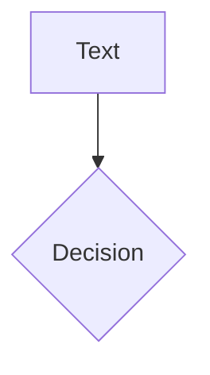
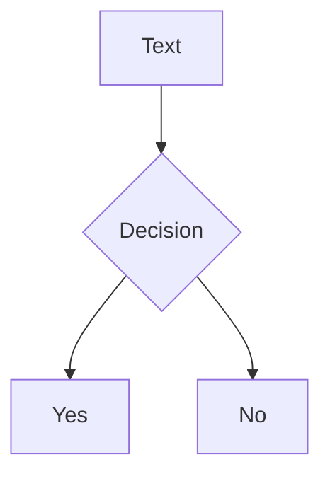

# Mermaid

Drawn in the browser; the library is loaded only when a deck has a diagram. Options come after the language.

````md

````

- `theme` defaults to `dark` or `default` following the colour mode. Any other key goes to Mermaid's `initialize`.
- While a diagram is drawn its element has `data-slide-ng-waitfor`; the export waits for it to go away.
- `<slide-ng-mermaid code="..." />` works as a tag too.
- Global config: `setup/mermaid.ts`, see `setup-mermaid.md`.

<!-- verify -->

````md
---
title: Mermaid
---

# Diagram


````
