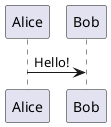

# PlantUML

A picture from a PlantUML server, so the browser needs the network (also in an offline folder).

````md

````

Set the server in the headmatter: `plantUmlServer: https://www.plantuml.com/plantuml` (the default).

<!-- verify -->

````md
---
title: PlantUML
plantUmlServer: https://www.plantuml.com/plantuml
---

# Sequence


````
