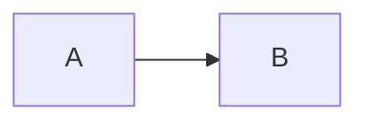

# setup/mermaid.ts

Returns Mermaid's config (`theme`, `themeVariables`, `flowchart`, ...). It applies to every diagram; a diagram's own options come after it. Configs of all roots are put over each other.

<!-- verify-file: setup/mermaid.ts -->

```ts
export default () => ({ theme: 'base', themeVariables: { primaryColor: '#ff0000' } });
```

<!-- verify -->

````md
---
title: Mermaid setup
---

# Red diagram


````
